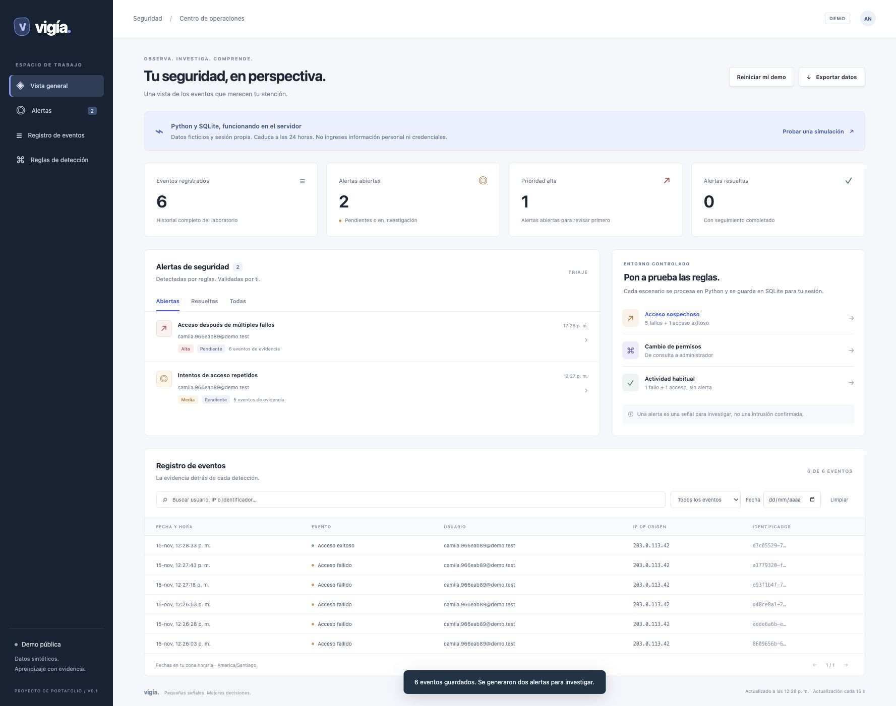

# Vigía · Panel de eventos de seguridad

[](https://github.com/Bogotor/security-events-dashboard/actions/workflows/tests.yml)

Proyecto de portafolio para recibir eventos de una aplicación de prueba, detectar comportamientos sospechosos y documentar su investigación.

**[Probar la demo pública](https://bogotor.alwaysdata.net/)** · Sin registro ni instalación. Usa únicamente datos ficticios.


## Stack

| Parte | Tecnología | Responsabilidad |
| --- | --- | --- |
| Servidor y API | Python 3.9+, biblioteca estándar y entrada WSGI | Validación, recepción de eventos e investigaciones |
| Almacenamiento | SQLite | Persistencia local de eventos, alertas y notas |
| Interfaz | HTML, CSS y JavaScript sin frameworks | Panel adaptable, filtros, simulaciones y evidencia |
| Detección | Reglas temporales en Python | Secuencias de fallos, accesos posteriores y cambios de permisos |
| Pruebas | unittest | Detecciones, transacciones, persistencia y controles HTTP |
| Integración continua | GitHub Actions | Pruebas en Python 3.9, 3.12 y 3.14, y revisión de sintaxis JavaScript |

**Estado:** demo pública desplegada en Alwaysdata Free y versión local funcional. Las alertas requieren investigación y no confirman por sí solas una intrusión.

## Ejecutar en tu computador

Requisito: Python 3.9 o superior. No requiere pip, Node, Docker, cuenta en la nube ni una API de IA.

Desde esta carpeta:

```sh
python3 app.py
```

Abrir http://127.0.0.1:8765 en el navegador. Para detener el servidor, presionar `Ctrl+C` en su terminal. Si el puerto está ocupado, ejecutar `python3 app.py --port 8766` y usar esa dirección.

Los eventos y las investigaciones se conservan en `data/events.sqlite3`. El archivo `data/ingest.token` contiene una credencial de ingesta local. Toda la carpeta `data/` está excluida de Git y no debe publicarse. No se precargan eventos: las simulaciones crean los datos de ejemplo cuando las ejecutas.

## Probar el recorrido principal

1. Pulsar **Acceso sospechoso**. Aparecen seis eventos y dos alertas: intentos repetidos y acceso después de múltiples fallos.
2. Abrir la alerta de prioridad alta y revisar los seis eventos de evidencia.
3. Elegir **En investigación**, añadir una nota y guardar.
4. Abrir la misma alerta, completar la nota y marcar **Resuelta**. Aparecerá en la pestaña Resueltas.
5. Pulsar **Actividad habitual**. Agrega dos eventos sin crear alertas nuevas.
6. Pulsar **Cambio de permisos**. Agrega un evento y una alerta con los roles anterior y nuevo.
7. Probar búsqueda por usuario o IP, filtro de tipo, fecha local y paginación. Usar **Exportar datos** para descargar eventos, alertas y notas como JSON; no incluye la credencial de ingesta y no sustituye una copia restaurable de SQLite.

Cada simulación usa una cuenta ficticia diferente para evitar mezclar escenarios. Las métricas muestran todos los datos guardados; los filtros solo afectan la tabla de eventos. Las alertas tienen su propio filtro de estado. El panel consulta cambios cada 15 segundos, excepto mientras hay un diálogo abierto o se ejecuta una simulación.


## Demo completa para Alwaysdata

La demo está publicada en **https://bogotor.alwaysdata.net/** desde el 15 de noviembre de 2026. Se verificaron HTTPS, detecciones en Python, separación entre visitantes y conservación de eventos y notas tras reiniciar el sitio.

La demo ejecuta las detecciones en **Python** y guarda los datos en **SQLite en el servidor**. Cada visitante tiene una sesión propia de 24 horas, con escenarios ficticios, límites de uso, exportación y reinicio independiente. La ingesta externa de registros reales está deshabilitada en esta entrada.

Para previsualizar ese modo en tu computador:

```sh
python3 webapp.py
```

Abrir http://127.0.0.1:8766. Este servidor es solo para desarrollo. En Alwaysdata se usa `wsgi.py` detrás de su servidor HTTPS y WSGI.



Ver [guía de despliegue, límites y respaldos](docs/DESPLIEGUE-ALWAYSDATA.md).

## Enviar un evento a la API

Este ejemplo es para la entrada local `app.py`; la demo pública no admite ingesta externa. Con el servidor local iniciado, desde otra terminal en esta carpeta:

```sh
python3 examples/send_event.py
python3 examples/send_event.py --type login_success
python3 examples/send_event.py --type role_changed
```

El ejemplo envía un evento para `analista@demo.test` a `POST /api/events`. Genera un identificador único y una fecha UTC actual, y lee la credencial desde `data/ingest.token` sin mostrarla. Repetir cinco veces el primer comando dentro de cinco minutos y luego enviar un acceso exitoso permite observar las dos reglas de autenticación con la misma cuenta. El cambio de permisos utiliza los roles `viewer` y `admin`.

Si usas otro puerto, añade `--port 8766`. El parámetro `--user otra-cuenta@demo.test` permite separar escenarios. Envía únicamente datos ficticios.

Formato de un evento (la fecha y el identificador del script se generan al ejecutarlo):

```json
{
  "event_id": "evento-de-ejemplo-001",
  "occurred_at": "2026-11-15T12:00:00Z",
  "type": "login_failed",
  "user": "analista@demo.test",
  "source_ip": "192.0.2.25",
  "metadata": {}
}
```

Ver [contrato de la API y reglas](docs/ARQUITECTURA.md) para los campos admitidos y sus límites.

## Pruebas

```sh
python3 -m unittest discover -s tests -v
```

Las pruebas HTTP abren un puerto temporal en la interfaz local. Se verifican ventanas temporales, separación por cuenta, reinicio de secuencias al ingresar, recepción fuera de orden, idempotencia, transacciones, persistencia y controles HTTP.

## Objetivo

Demostrar el ciclo completo de una solución: definición del problema, implementación, pruebas de detección, despliegue y documentación de resultados y limitaciones.

## Primera versión

- Recibir eventos estructurados de accesos exitosos, accesos fallidos y cambios de permisos.
- Guardar eventos y alertas en una base de datos local.
- Mostrar un panel con filtros por usuario, tipo de evento y fecha.
- Detectar cinco accesos fallidos para una misma cuenta en cinco minutos.
- Detectar un acceso exitoso precedido por esos fallos dentro de la misma ventana.
- Alertar cuando cambia el rol de un usuario.
- Permitir marcar una alerta como pendiente, en investigación o resuelta, con una nota.
- Generar escenarios sintéticos reproducibles para demostrar cada regla.

Los umbrales iniciales son decisiones del proyecto, no valores universales. Se documentarán sus falsos positivos y limitaciones. Una alerta indica que se necesita revisión, no que se confirmó un ataque.

## Componentes implementados

1. Generador de eventos sintéticos.
2. API de recepción con validación de datos y credencial para la ingesta.
3. Almacenamiento SQLite para la primera versión local.
4. Motor de reglas basado en ventanas de tiempo.
5. Panel web de eventos, alertas y notas de investigación.

No requiere un modelo de IA ni una API de pago. Las detecciones iniciales serán reglas explícitas y verificables.

## Costos y publicación

La demo utiliza Alwaysdata **Free (0 €)** con su subdominio gratuito, Python WSGI y almacenamiento persistente para SQLite. No se contrató un plan de pago ni un dominio propio.

El plan tiene límites de recursos y condiciones de actividad: durante el primer año hay que entrar al panel administrativo al menos cada 120 días. Ver [condiciones y mantenimiento](docs/DESPLIEGUE-ALWAYSDATA.md).

Cada visitante trabaja con datos sintéticos y una sesión temporal separada. La persistencia entre reinicios del sitio se verificó; las sesiones caducan a las 24 horas por diseño.

## Evidencias que debe incluir el portafolio

- Instrucciones reproducibles para ejecutar la aplicación.
- Diagrama de arquitectura y modelo de eventos.
- Pruebas de límites temporales, escenarios normales y eventos que generan alertas.
- Tratamiento de eventos duplicados y fuera de orden, o documentación explícita de esas limitaciones.
- Investigación de ejemplo: evento, detección, evidencia, posible falso positivo y resolución.
- Capturas y un video breve de la demo.
- Decisiones técnicas, riesgos conocidos y mejoras futuras.

## Manejo de datos

Usar identificadores y direcciones de ejemplo. No registrar contraseñas, tokens ni secretos. Mantener la recepción de eventos y las funciones de administración restringidas cuando se publique.

## Documentación

- [Arquitectura, API y límites](docs/ARQUITECTURA.md).
- [Investigación de ejemplo](docs/INVESTIGACION-EJEMPLO.md).
- [Resultados de validación](docs/VALIDACION.md).
- [Despliegue completo en Alwaysdata](docs/DESPLIEGUE-ALWAYSDATA.md).
- [Recordatorio: publicación y presentación a reclutadores](docs/CIERRE-PORTAFOLIO.md).

## Estado y siguiente etapa

Primera versión local implementada. Incluye API con ingesta autenticada, almacenamiento persistente, motor de reglas, panel, simulaciones, filtros, exportación e investigaciones.

El código está publicado en [GitHub](https://github.com/Bogotor/security-events-dashboard) y la demo en [Alwaysdata](https://bogotor.alwaysdata.net/). La entrada local escucha exclusivamente en el computador del autor. La entrada pública WSGI incorpora sesiones aisladas, controles de origen y límites. Se verificaron en el alojamiento real HTTPS, aislamiento y persistencia tras un reinicio.

Pendientes de presentación: grabar el video breve y añadir los enlaces de demo, código y video al CV y LinkedIn, según el recordatorio de cierre. El despliegue se actualiza manualmente; todavía no hay despliegue continuo configurado.


## Licencia

Por decisión del autor, esta versión se publica sin una licencia de reutilización.
