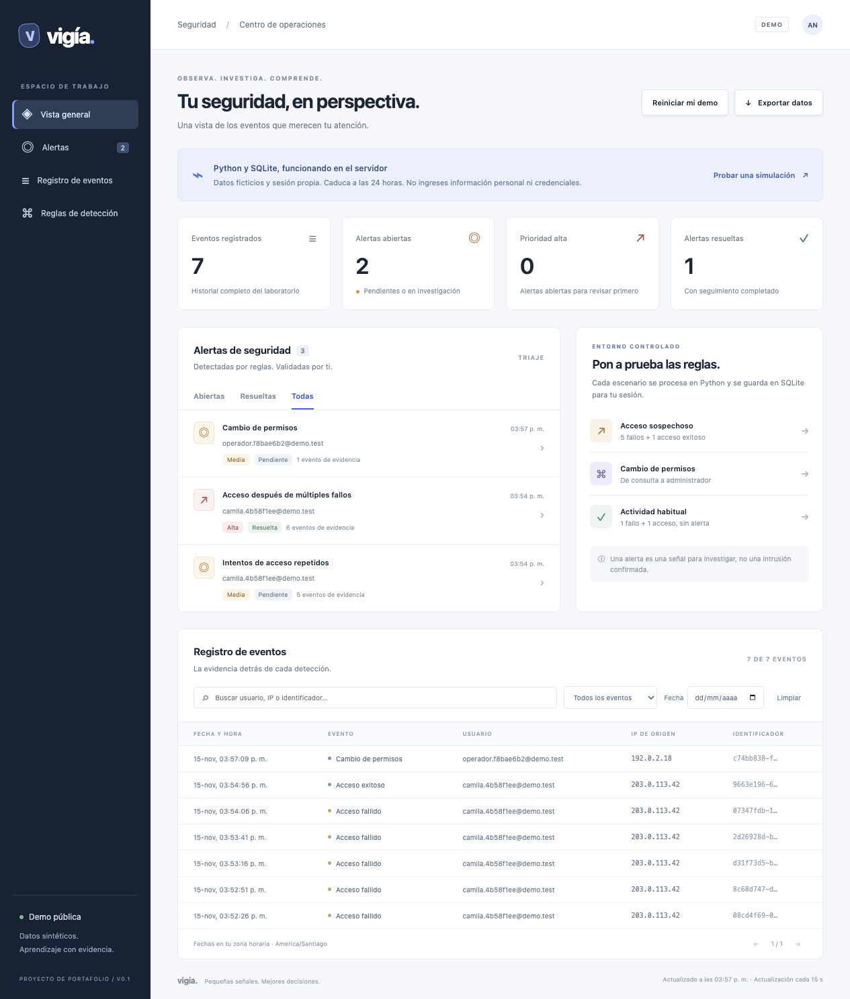

# Vigía · Detección e investigación de eventos de seguridad

[](https://github.com/Bogotor/security-events-dashboard/actions/workflows/tests.yml)

**Vigía es una aplicación web que transforma eventos de acceso y cambios de permisos en alertas con evidencia para investigar.** Es un proyecto de portafolio con backend Python, persistencia SQLite, pruebas automatizadas y una demo completa desplegada por HTTPS.

**[Probar la demo pública](https://bogotor.alwaysdata.net/)** · Sin registro ni instalación · Datos sintéticos · Sesiones independientes.



## Qué problema aborda

Una aplicación puede registrar muchos intentos de acceso sin hacer evidente una secuencia sospechosa. Por ejemplo, cinco fallos seguidos de un acceso exitoso podrían pasar inadvertidos al revisar los registros por separado.

Vigía agrupa esos eventos por cuenta, aplica reglas temporales y presenta una alerta con los eventos que la originaron. Una persona puede revisar la evidencia, registrar una hipótesis y documentar el cierre de la investigación.

El usuario objetivo sería quien administra una aplicación o revisa su seguridad. El beneficio esperado es facilitar la identificación y revisión de actividad sospechosa; **todavía no se ha medido ese beneficio con usuarios reales**.

**Alcance actual:** prototipo educativo funcional. La demo genera sus propios eventos; no está conectada a una aplicación externa, no vigila el computador del visitante y no confirma ni bloquea ataques automáticamente.

## Probarlo en dos minutos

1. Abrir la [demo](https://bogotor.alwaysdata.net/) y pulsar **Acceso sospechoso**. Se guardan seis eventos y aparecen dos alertas.
2. Abrir **Acceso después de múltiples fallos** y revisar sus seis eventos de evidencia: cuenta, IP, horas y secuencia.
3. Seleccionar **En investigación**, escribir una nota y guardar. Después marcar **Resuelta** con una conclusión. La alerta pasa a la pestaña Resueltas.
4. Probar **Actividad habitual**: un fallo y un acceso exitoso no generan una alerta nueva. **Cambio de permisos** sí genera una.

Los filtros inferiores afectan al registro de eventos; las pestañas filtran las alertas. Los contadores superiores resumen toda la sesión. **Exportar datos** descarga eventos, alertas y notas en JSON; **Reiniciar mi demo** borra únicamente los datos de la sesión propia.

Cada visitante comienza con una sesión independiente que caduca a las 24 horas. Las detecciones se ejecutan en **Python** y los datos se guardan en **SQLite en el servidor**. Usar únicamente información ficticia, también en las notas.

## Qué detecta

| Regla | Condición | Qué conviene investigar |
| --- | --- | --- |
| Intentos repetidos | Al menos cinco fallos de una cuenta dentro de cinco minutos | Errores legítimos o intentos de adivinar la contraseña |
| Acceso después de fallos | Un acceso exitoso tras al menos cinco fallos dentro de cinco minutos | Si el propietario reconoce el acceso |
| Cambio de permisos | Un cambio entre dos roles diferentes | Si existe una solicitud autorizada para ese cambio |

Un acceso exitoso reinicia la secuencia de fallos de esa cuenta. La primera regla suprime alertas repetidas durante cinco minutos. Los umbrales son decisiones del prototipo; **una alerta es una señal para revisar, no una intrusión confirmada**.

Ver la [investigación de ejemplo](docs/INVESTIGACION-EJEMPLO.md) y las [reglas, API y casos límite](docs/ARQUITECTURA.md).

## Cómo funciona

```text
Evento -> API Python -> SQLite -> Reglas temporales -> Alerta con evidencia
                                                            |
                                                   Revisión y nota del analista
```

El proyecto tiene dos entradas que reutilizan el mismo motor de detección:

| Entrada | Uso | Origen de los eventos |
| --- | --- | --- |
| `app.py` | Laboratorio local y pruebas de integración | Escenarios incluidos o API de ingesta con credencial local |
| `wsgi.py` / `webapp.py` | Demo pública en Alwaysdata | Solo escenarios sintéticos incluidos; ingesta externa deshabilitada |

## Stack y decisiones

| Tecnología o decisión | Motivo y límite |
| --- | --- |
| Python 3.9+ y biblioteca estándar | Permite ejecutar el proyecto sin instalar paquetes externos. La entrada pública usa WSGI y el alojamiento ejecuta Python 3.12. |
| SQLite | Conserva eventos, alertas y notas sin un servidor de base de datos adicional. Las escrituras se serializan; el proyecto no está preparado para grandes volúmenes. |
| HTML, CSS y JavaScript sin frameworks | Interfaz sin compilación. JavaScript presenta los resultados; el motor de detección permanece en Python. |
| Reglas explícitas | Permiten explicar cada alerta y su evidencia. Detectan únicamente los patrones implementados y pueden producir falsos positivos. |
| Sesiones públicas de 24 horas | Separan los datos entre visitantes y limitan la retención. La demo no implementa cuentas de analistas ni está pensada para datos reales. |
| `unittest` y GitHub Actions | Pruebas automáticas en Python 3.9, 3.12 y 3.14; comprobación de sintaxis del cliente JavaScript. |

No se usa una API de IA para detectar eventos. El funcionamiento de las reglas es determinista.

## Qué se ha verificado

- **39 pruebas automatizadas:** ventanas temporales, duplicados, eventos fuera de orden, transacciones, persistencia, sesiones, controles HTTP, cuotas y respaldo/restauración.
- **Despliegue real:** las 39 pruebas aprobaron con Python 3.12 en Alwaysdata; eventos y notas se conservaron después de reiniciar el sitio.
- **Aislamiento y acceso:** dos clientes HTTP independientes no comparten datos ni pueden modificar alertas ajenas. Se verificaron cookies protegidas, redirección HTTPS y bloqueo de rutas privadas.
- **Respaldo:** se creó y verificó una instantánea consistente de SQLite en el alojamiento. La restauración se prueba en un entorno aislado; no se hizo una restauración destructiva de la demo pública.

Los [resultados de validación](docs/VALIDACION.md) documentan la evidencia y sus límites. No se han realizado pruebas de carga, una auditoría independiente ni una revisión exhaustiva de accesibilidad.

## Ejecutar localmente

Requisito: **Python 3.9 o superior**. No requiere pip, Node, Docker ni una cuenta en la nube para ejecutarse.

```sh
git clone https://github.com/Bogotor/security-events-dashboard.git
cd security-events-dashboard
python3 app.py
```

Abrir **http://127.0.0.1:8765**. Detener el servidor con `Ctrl+C`. Se puede elegir otro puerto con `python3 app.py --port 8767`.

Los datos locales se guardan en `data/events.sqlite3` y la credencial de ingesta en `data/ingest.token`. La carpeta `data/`, las credenciales y los archivos `.env` están excluidos de Git.

Para previsualizar el modo público, ejecutar `python3 webapp.py` y abrir **http://127.0.0.1:8766**. Ambas entradas locales son servidores de desarrollo; Alwaysdata ejecuta `wsgi.py` detrás de su servidor WSGI y HTTPS.

### Enviar eventos a la API local

Con `app.py` iniciado, ejecutar desde otra terminal en la carpeta del proyecto:

```sh
python3 examples/send_event.py
python3 examples/send_event.py --type login_success
python3 examples/send_event.py --type role_changed
```

El ejemplo genera una fecha UTC y un identificador único, y lee la credencial sin mostrarla. Repetir cinco veces el primer comando dentro de cinco minutos y después enviar el acceso exitoso permite probar las dos reglas de autenticación con la misma cuenta ficticia. Este ejemplo no envía datos a la demo pública.

### Ejecutar las pruebas

```sh
python3 -m unittest discover -s tests -v
```

Las pruebas de integración abren puertos temporales en la interfaz local. Node solo se utiliza en integración continua para comprobar la sintaxis de JavaScript.

## Despliegue y mantenimiento

La demo utiliza **Alwaysdata Free (0 €)**, su subdominio y almacenamiento persistente para SQLite. El plan tiene límites y condiciones de actividad; durante el primer año se requiere entrar al panel administrativo al menos cada 120 días. Las sesiones de la demo caducan a las 24 horas por diseño.

El despliegue se actualiza manualmente desde GitHub; las pruebas están automatizadas, la publicación todavía no. La [guía de Alwaysdata](docs/DESPLIEGUE-ALWAYSDATA.md) incluye configuración WSGI, límites, copias consistentes y restauración.

## Limitaciones y siguiente versión

La siguiente mejora funcional es **conectar una aplicación de inicio de sesión que envíe eventos automáticamente** y demostrar la detección de principio a fin. Por ahora esa integración externa no está implementada.

Las reglas agrupan por cuenta, no detectan todos los tipos de ataque y no sustituyen una investigación. La demo limita eventos, sesiones y frecuencia de acciones; no es una plataforma de seguridad empresarial ni se ha evaluado su eficacia operativa.

## Desarrollo asistido por IA

El código, las pruebas y la documentación se desarrollaron con asistencia de IA. El repositorio incluye las comprobaciones automatizadas y los resultados observados del despliegue. El objetivo de aprendizaje es poder explicar y revisar el funcionamiento, las decisiones y los límites del sistema, además de mantenerlo disponible.

## Documentación

- [Arquitectura, modelo de eventos y API](docs/ARQUITECTURA.md).
- [Caso de investigación y posible falso positivo](docs/INVESTIGACION-EJEMPLO.md).
- [Resultados de validación](docs/VALIDACION.md).
- [Despliegue y operación en Alwaysdata](docs/DESPLIEGUE-ALWAYSDATA.md).
- [Pendientes de presentación del portafolio](docs/CIERRE-PORTAFOLIO.md).

## Licencia

Por decisión del autor, esta versión se publica sin una licencia de reutilización.
